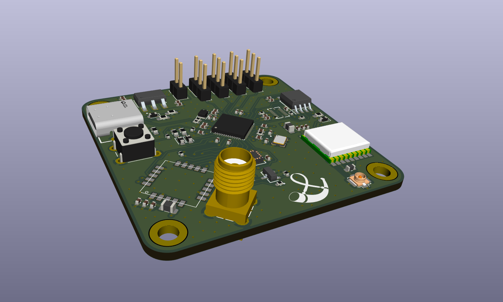
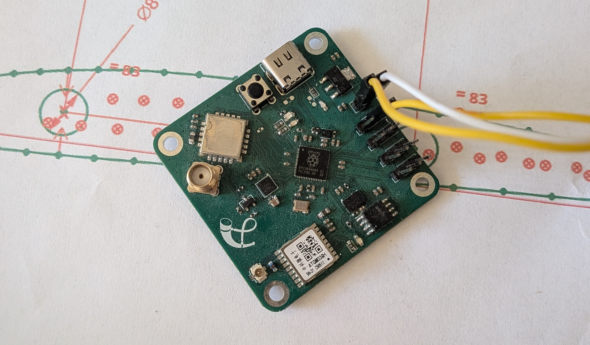

# General Vehicle OnBoard Unit

## Description
This is a very simple controller board for RC planes/boats/cars.

## Specification

- Radio link on 443MHz via LoRa (LLCC68)
- Logging on onboard flash (W25Q32)
- Accelerometer (BMI088)
- Gyroscope (BMI088)
- Magnetometer (MMC5983MA)
- GPS (ATGM336H-5N31)
- 4 PWM outputs for servo/motor control
- Powered from battery or ESC BEC
- USB interface for debug/data download
- Main uC RP2350

## Todo
- sensor fusion with kalman filter
